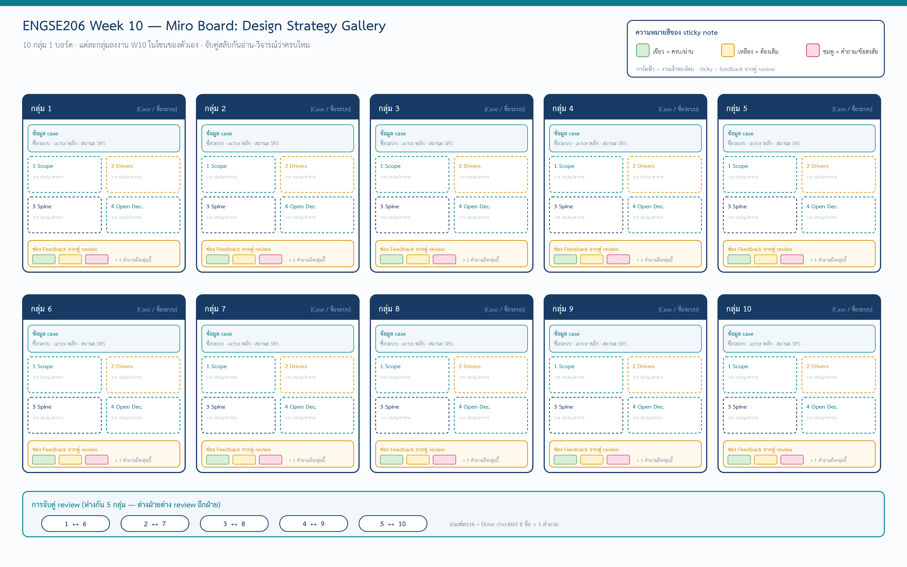
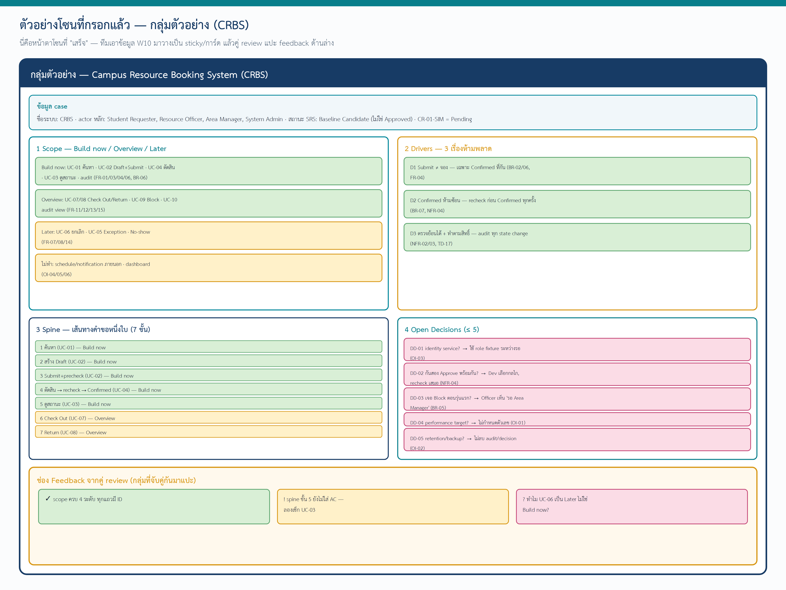

# ENGSE206 Week 10 — คู่มือสร้าง Miro Board (Design Strategy Gallery)

> **บอร์ดนี้ทำอะไร:** 10 กลุ่ม เอางาน W10 (Scope / Drivers / Spine / Open Decisions) มาลงบอร์ดเดียวกัน กลุ่มละ 1 โซน แล้วจับคู่กันอ่าน-วิจารณ์ว่าครบไหม
> **ทำที่:** [miro.com](https://miro.com) (สมัครฟรี/ใช้บัญชีมหาวิทยาลัย) — อาจารย์สร้างบอร์ดกลางแล้วแชร์ลิงก์ให้ทุกกลุ่ม หรือให้แต่ละกลุ่มทำโซนของตัวเองในบอร์ดเดียวกัน
> **ดูภาพประกอบ:** `images/miro-board-overview.png` (ทั้งบอร์ด) และ `images/miro-zone-example-crbs.png` (โซนที่กรอกแล้ว)

---

## 1. ภาพรวมบอร์ด

บอร์ดแบ่งเป็น **10 โซน** เรียง 2 แถว แถวละ 5 กลุ่ม (กลุ่ม 1–5 แถวบน, กลุ่ม 6–10 แถวล่าง) ด้านล่างมีแถบ "การจับคู่ review"

แต่ละโซนมี 4 ส่วน (บนลงล่าง):
1. **หัวโซน** — เลขกลุ่ม + ชื่อระบบ/case
2. **การ์ดข้อมูล case** — ชื่อระบบ, actor หลัก, สถานะ SRS
3. **4 ช่องงาน W10** — Scope, Drivers, Spine, Open Decisions
4. **ช่อง Feedback จากคู่ review** — sticky note จากกลุ่มที่จับคู่กัน

---

## 2. การจับคู่ review

จับคู่แบบ **ห่างกัน 5 กลุ่ม** (คู่ review นั่งคนละครึ่งห้อง ลดการเกรงใจกัน):

| คู่ที่ | กลุ่ม review ↔ กลุ่ม |
|---|---|
| 1 | กลุ่ม 1 ↔ กลุ่ม 6 |
| 2 | กลุ่ม 2 ↔ กลุ่ม 7 |
| 3 | กลุ่ม 3 ↔ กลุ่ม 8 |
| 4 | กลุ่ม 4 ↔ กลุ่ม 9 |
| 5 | กลุ่ม 5 ↔ กลุ่ม 10 |

**ต่างฝ่ายต่าง review อีกฝ่าย** — กลุ่ม 1 อ่านและแปะ feedback ในโซนกลุ่ม 6 พร้อมกันกับที่กลุ่ม 6 อ่านโซนกลุ่ม 1

> ถ้ามีกลุ่มไม่ครบ 10 อาจารย์ปรับคู่ได้ (เช่น 8 กลุ่ม → 1↔5, 2↔6, 3↔7, 4↔8)

---

## 3. สร้างบอร์ดทีละขั้น (สำหรับผู้สร้างโซน)

### ขั้นที่ 1 — สร้าง Frame ของกลุ่ม

1. ใน Miro กด **Frame** (ไอคอนสี่เหลี่ยม หรือกด `F`)
2. ตั้งชื่อ frame ว่า `กลุ่ม N — [ชื่อระบบ]`
3. ขนาดแนะนำ: กว้างพอวาง 2 คอลัมน์ (ประมาณ 1900×1300 px ถ้าอิงภาพตัวอย่าง)

### ขั้นที่ 2 — วางการ์ดข้อมูล case (บนสุด)

ใช้ **Sticky note สีฟ้าอ่อน** หรือ **Text box** วาง 1 อัน เขียน:
- **ชื่อระบบ:** [ชื่อ case ของกลุ่ม]
- **actor หลัก:** [ผู้ใช้หลัก 2–4 คน]
- **สถานะ SRS:** [Draft / Needs Revision / Baseline Candidate] — *ไม่เขียน Approved*

### ขั้นที่ 3 — สร้าง 4 ช่องงาน W10

วาง 4 กล่อง (ใช้ **Shape สี่เหลี่ยม** เป็นกรอบ แล้ววาง sticky ข้างใน) ตามนี้:

| ช่อง | สีกรอบ | เอาอะไรมาวาง |
|---|---|---|
| **1 Scope** | teal | sticky แยกตามกอง Build now / Overview / Later / ไม่ทำ + requirement ID |
| **2 Drivers** | amber | sticky 3 ใบ = 3 drivers อ้าง ID + ผลต่อ W11/12/13 |
| **3 Spine** | navy | sticky เรียงเป็นแถว = 5–8 ขั้น (มี UC + ระดับ Build now/Overview) |
| **4 Open Decisions** | teal เข้ม | sticky = DD แต่ละข้อ (คำถาม + เจ้าของ + วิธีระหว่างรอ) |

### ขั้นที่ 4 — ใช้สี sticky ให้สื่อความหมาย

| สี | ความหมาย | ใช้ตอนไหน |
|---|---|---|
| **เขียว** | ครบ / มั่นใจ | scope ที่ Build now, driver ที่อ้าง ID ได้ชัด |
| **เหลือง** | ต้องเติม / ยังไม่แน่ | scope ที่ Later, ข้อที่ยังไม่ครบ |
| **ชมพู** | คำถาม / ข้อสงสัย | Open Decisions, จุดที่ทีมยังไม่รู้คำตอบ |

### ขั้นที่ 5 — เว้นช่อง Feedback ไว้ด้านล่าง

วาง **Shape สี่เหลี่ยมสีเหลืองอ่อน** กว้างเต็มโซน เขียนหัวว่า *"Feedback จากคู่ review"* — เว้นว่างไว้ให้คู่มาแปะ sticky

> **ดูโซนที่กรอกเสร็จแล้วเป็นตัวอย่าง:** `images/miro-zone-example-crbs.png` (CRBS ของอาจารย์)

---

## 4. กติกาการ review (สำคัญ)

เมื่อถึงเวลา review ให้เข้าไปที่โซนของกลุ่มที่จับคู่ อ่านงานเขา แล้ว **แปะ sticky ในช่อง Feedback** ตาม **Done checklist 6 ข้อของ W10**:

| # | เช็กว่า... | ติ๊ก |
|---|---|---|
| 1 | scope table แบ่ง 4 ระดับ (Build now/Overview/Later/ไม่ทำ) โดยไม่ลบ FR จาก SRS | ☐ |
| 2 | ทุกแถวใน scope มี requirement ID อย่างน้อย 1 ตัว | ☐ |
| 3 | drivers 3 ข้อ แต่ละข้ออ้าง ID และบอกผลต่อ W11/12/13 | ☐ |
| 4 | Spine 5–8 แถว มี actor + UC ทุกแถว เรียงตามผู้ใช้ทำจริง | ☐ |
| 5 | open decisions ≤ 5 มีเจ้าของ + ผลกระทบ + วิธีระหว่างรอ ไม่มีค่าที่แต่งขึ้น | ☐ |
| 6 | สถานะ SRS ตามจริง ไม่อ้าง Approved | ☐ |

**วิธีแปะ feedback:**
- ✅ **sticky เขียว** = "ข้อนี้ครบดี" (ระบุว่าข้อไหน)
- ⚠️ **sticky เหลือง** = "ข้อนี้ยังต้องเติม" (บอกว่าขาดอะไร เช่น "spine ขั้น 5 ไม่มี AC")
- ❓ **sticky ชมพู** = **1 คำถามที่อยากถามกลุ่มนี้** (บังคับอย่างน้อย 1 ใบต่อคู่ เช่น "ทำไม UC-06 เป็น Later ไม่ใช่ Build now?")

> **กติกามารยาท:** feedback ชี้ที่งาน ไม่ใช่ที่คน · บอกว่า "ขาดอะไร" ไม่ใช่แค่ "ผิด" · ทุกใบเหลือง/ชมพูควรช่วยให้กลุ่มนั้นแก้ได้

---

## 5. Timeline ในคาบ (ประมาณ 40–50 นาที)

| ช่วง | เวลา | ทำอะไร |
|---|---:|---|
| เตรียมโซน | 15 | แต่ละกลุ่มลงงาน W10 ในโซนตัวเอง (ถ้าทำมาแล้วแค่จัดให้อ่านง่าย) |
| Review รอบ 1 | 12 | เข้าไปโซนคู่ของตัวเอง อ่าน + แปะ feedback ตาม checklist 6 ข้อ + 1 คำถาม |
| ตอบกลับ | 8 | กลับโซนตัวเอง อ่าน feedback ที่ได้ ตอบ/แก้ sticky เหลือง-ชมพู |
| สรุปรวม | 10 | อาจารย์เปิดทีละโซน ชี้จุดที่หลายกลุ่มพลาดเหมือนกัน (misconception ร่วม) |

> นี่เป็น **gallery walk แบบ digital** — ไม่นับเป็น peer review ที่บันทึกเป็นคะแนน แต่เป็นการช่วยกันตรวจความครบก่อนส่งจริงก่อนคาบ W11

---

## 6. Checklist ก่อนจบคาบ

- [ ] ทุกกลุ่มมีโซนครบ 4 ช่อง (Scope / Drivers / Spine / Open Decisions) + การ์ด case
- [ ] ทุกโซนได้รับ feedback จากคู่ review อย่างน้อย: เขียว 1 + (เหลืองหรือชมพู) 1 + คำถาม 1
- [ ] แต่ละกลุ่มอ่าน feedback ที่ได้ และตอบ/แก้ในโซนตัวเอง
- [ ] บันทึกภาพหน้าจอโซนตัวเอง (ก่อน/หลัง feedback) เก็บใน `evidence/week-10/` ของ Team Repo

---

*บอร์ดนี้เป็นกิจกรรมเสริมของ Week 10 — งานหลักที่ต้องส่งยังเป็น `design/10-design-strategy.md` + `design/00-design-spine.md` ใน Team Repo ตาม Assignment W10-v1.0*
