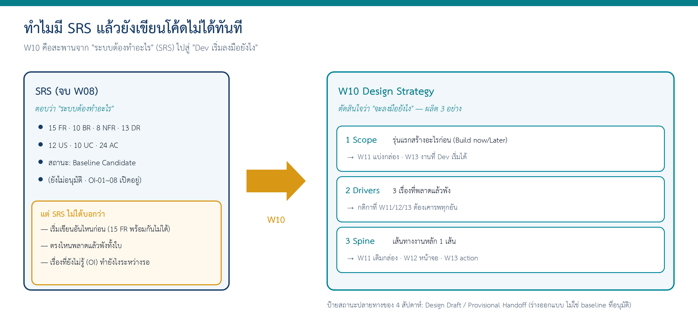

# CRBS — Design Strategy v0.1 (ตัวอย่างที่ทำเสร็จแล้ว สำหรับ Week 10)

> **เอกสารนี้อ่านยังไง:** นี่ไม่ใช่ "ฟอร์มที่กรอกเสร็จ" ให้ลอก แต่เป็น **"เรามาลองทำ Design Strategy ไปด้วยกัน"** โดยใช้กรณีศึกษา Campus Resource Booking System (CRBS) เป็นตัวเดินเรื่อง แต่ละส่วนจะมี 3 ชั้น:
> - 🟦 **มาลองทำไปด้วยกัน** — เรากำลังคิดอะไร มองหาอะไรใน SRS ตัดสินใจยังไง
> - 📋 **ผลลัพธ์** — ตารางที่เต็มแล้ว (สิ่งที่ทีมต้องส่ง)
> - ✋ **จุดชวนคิด** — คำถามที่เอาไปถามกับ case ของทีมตัวเอง
>
> ทีมของเราจะทำเอกสารโครงเดียวกันนี้ให้ case ของตัวเอง — **ดูวิธีคิด ไม่ใช่ลอกคำตอบ** (CRBS เป็นกรณีสอน ไม่ใช่นโยบายจริงของมหาวิทยาลัย)

---

# ส่วน A — ก่อนเริ่ม: ทำไมต้องมี Week 10?

## A.1 พอมี SRS แล้ว ทำไมยังเขียนโค้ดไม่ได้ทันที?

จบ Week 08 เรามี **SRS** อยู่ในมือแล้ว — เอกสารที่บอกว่า *"ระบบต้องทำอะไร"* ครบทุกข้อ (CRBS มี 15 FR, 10 BR, 8 NFR, 13 DR) ฟังดูเหมือนพร้อมส่งให้ Dev เขียนโค้ดได้เลย

แต่ลองนึกภาพว่าเราเป็น Dev ที่เพิ่งได้ SRS 30 หน้ามา คำถามแรกที่เกิดขึ้นคือ **"แล้วให้ฉันเริ่มเขียนอันไหนก่อน?"** — SRS ไม่ได้ตอบ เพราะ SRS บอกแค่ว่าต้องมีอะไรบ้าง ไม่ได้บอกว่า:

- **เริ่มอันไหนก่อน** — เขียน 15 FR พร้อมกันไม่ได้ ต้องมีรุ่นแรกที่ "ใช้งานได้จริง 1 รอบ"
- **ตรงไหนพลาดแล้วพังทั้งใบ** — บาง FR ถ้าออกแบบผิดคือระบบใช้ไม่ได้เลย บาง FR ผิดแล้วซ่อมทีหลังได้
- **เรื่องที่ SRS ยังไม่รู้คำตอบ** (Open Issues OI-01–08) — จะให้ Dev ทำยังไงระหว่างที่ยังไม่มีคำตอบ

> **อุปมาให้เห็นภาพ:** SRS เหมือน **รายการของทั้งบ้านที่เราอยากได้** (ครัว 3 ห้องนอน โรงรถ สระว่ายน้ำ) — ครบ ถูกต้อง แต่สร้างพร้อมกันทั้งหมดในเดือนแรกไม่ได้ **Week 10 คือตอนที่เราตัดสินใจว่า "เฟสแรกสร้างอะไรให้เข้าอยู่ได้จริงก่อน"** และ **"เสาต้นไหนที่พลาดไม่ได้"** (ถ้าเสาเอียง บ้านทั้งหลังพัง)

**Week 10 จึงเป็นครั้งแรกที่เราเปลี่ยนบทบาท** — จากคนที่เขียนว่า *"ระบบต้องทำอะไร"* (requirement) มาเป็นคนที่ตัดสินใจว่า *"จะลงมือสร้างยังไง"* (design)

## A.2 Week 10 เราผลิต 3 อย่าง แล้วเอาไปใช้อะไรต่อ?

Design Strategy ไม่ใช่งานที่ทำแล้วทิ้ง — ทุกอย่างที่เราทำวันนี้ **สัปดาห์ถัดไปจะหยิบไปเติมต่อ** ไม่ต้องเริ่มใหม่

| เราผลิต (W10) | ตอบคำถามอะไร | ใครเอาไปใช้ / สัปดาห์ไหน |
|---|---|---|
| **1. Scope** (Build now / Overview / Later) | รุ่นแรก Dev เริ่มสร้างอะไรก่อน | **W11** เอาไปแบ่งเป็นกล่อง · **W13** กลายเป็น "งานที่ Dev เริ่มได้" |
| **2. Design Drivers** (3 เรื่องห้ามพลาด) | ออกแบบยังไงไม่ให้ระบบพัง | เป็น **กติกา** ที่ W11/W12/W13 ต้องเคารพทุกอัน |
| **3. Design Spine** (เส้นทางงานหลัก 1 เส้น) | ทำให้ 4 สัปดาห์ต่อเนื่องกัน | **W11** เติมกล่อง · **W12** เติมหน้าจอ · **W13** เติม action บนแถวเดิม |

**ปลายทางของทั้ง 4 สัปดาห์** คือชุดเอกสารที่มีป้ายสถานะ **Design Draft / Provisional Handoff** (ร่างออกแบบ ยังไม่ใช่ baseline ที่อนุมัติ) ที่ทีม Dev อ่านแล้วแบ่งงาน sprint แรกได้

## A.3 หัวเอกสาร (Document Control)

| ช่อง | ค่า |
|---|---|
| Case | CRBS — Campus Resource Booking System (กรณีสอน) |
| เอกสารนี้คือ | `design/10-design-strategy.md` (+ `design/00-design-spine.md`) |
| Version / Status | v0.1 — **Design Draft** (ร่างออกแบบ ยังไม่ผ่านการอนุมัติ) |
| ฐาน SRS ที่ใช้ | `CRBS-SRS-W07-v1.1` สถานะ **Baseline Candidate — not approved baseline** (ตัวเต็งฐาน แต่ยังไม่อนุมัติ); Open Issues OI-01–OI-08 ยังเปิดอยู่ |
| Change request ที่รู้ | `CR-01-SIM` ("Submit แล้วกันทรัพยากรทันที") — สถานการณ์สมมติสำหรับฝึก สถานะ **Pending** *ไม่นำมาใช้ในแบบนี้* |
| ผู้จัดทำ | Instructor completed example (AI ช่วยจัดโครง ผู้สอนตรวจ) |

> **ศัพท์ที่จะเจอครั้งแรก** (คงคำอังกฤษ แต่มีคำอธิบายกำกับ)
> - **increment** = "รุ่นแรก" ก้อนงานที่ Dev สร้างก่อนในรอบแรก ไม่ใช่ทั้งระบบพร้อมกัน
> - **design driver** = "เรื่องที่ถ้าออกแบบพลาด ระบบนี้พัง" ตัวขับสำคัญที่กำหนดทิศทางออกแบบ
> - **design spine** = "แกนกลาง" เส้นทางงานหลักหนึ่งเส้นที่ทุกสัปดาห์เติมรายละเอียดลงไป
> - **open decision (DD)** = "เรื่องที่ยังไม่มีคำตอบ แต่ออกแบบต่อได้โดยตั้งวิธีชั่วคราวไว้"
> - **TBD** = To Be Determined = "ยังไม่กำหนด" — เขียนเป็นคำถาม ไม่ใช่เดาตัวเลขมาเติม

---

# ส่วน B — ลงมือทำ Design Strategy ทีละขั้น

> **ลำดับที่เราจะทำ** (ทำจากจับต้องได้ → นามธรรม): เขียนเส้นทางงานหลักก่อน (Spine) → จัดกองว่าอันไหนทำก่อน (Scope) → หาเรื่องที่พลาดไม่ได้ (Drivers) → จดสิ่งที่ยังไม่รู้ (Open Decisions)

## ขั้นที่ 1 — เขียนเส้นทางงานหลัก 1 เส้น (Design Spine)

### 🟦 มาลองทำไปด้วยกัน

เราเริ่มจากสิ่งที่จับต้องได้ที่สุดก่อน คือ **"งานหลักหนึ่งชิ้น" ของระบบวิ่งยังไงตั้งแต่ต้นจนจบ**

เปิด `docs/06-requirement-models.md` (งาน W06) ดูว่า Core use case ของ CRBS คืออะไร แล้วถามตัวเองว่า *"ผู้ใช้คนหนึ่งขอใช้ห้อง 1 ครั้ง เขาทำอะไรบ้าง เรียงจากต้นจนจบ?"*

เราไล่ได้แบบนี้: เขา**ค้นหา**ห้องว่างก่อน → **สร้างคำขอ (Draft)** → **กด Submit** → **เจ้าหน้าที่ตัดสิน** → เขา**ดูว่าผลเป็นยังไง** → (ถ้าเป็นอุปกรณ์) **มารับ** → **เอามาคืน**

นี่แหละคือ **Spine** — เส้นทางที่เราจะเติมรายละเอียดลงไปทุกสัปดาห์ ทีละคอลัมน์ สัปดาห์นี้เราเติมแค่คอลัมน์ "W10 ระดับ" (ว่าขั้นไหนทำก่อน) ที่เหลือปล่อยว่างไว้

> **ทำไมต้องใช้ "คำขอหนึ่งใบ" เป็นแกน?** เพราะมันคือเส้นที่ร้อยทุกส่วนของระบบเข้าด้วยกัน ถ้าเรารู้ว่าคำขอหนึ่งใบเดินยังไง เราจะรู้ว่าต้องมีกล่องอะไร (W11) หน้าจออะไร (W12) และ action อะไร (W13) — Spine ทำให้ 4 สัปดาห์เป็นเรื่องเดียวกัน ไม่ใช่ 4 เอกสารแยกกัน

### 📋 ผลลัพธ์: Design Spine v0.1 (คอลัมน์ W10)

ไฟล์ `design/00-design-spine.md` — คอลัมน์ W11–W13 ปล่อยว่างไว้ให้เติมสัปดาห์ถัดไป

| # | ขั้นในเส้นทางคำขอหนึ่งใบ | Actor | UC | AC หลัก | W10 ระดับ | W11 กล่อง | W12 หน้าจอ | W13 action/data/rule |
|---|---|---|---|---|---|---|---|---|
| 1 | ค้นหาทรัพยากรที่ว่างตามประเภท/วัน/เวลา | Requester | UC-01 | AC-01–04 | Build now | | | |
| 2 | สร้าง/แก้ Draft (ยังไม่กันทรัพยากร) | Requester | UC-02 | AC-08 | Build now | | | |
| 3 | Submit → ตรวจข้อมูลขั้นต่ำ → Submitted + เลขอ้างอิง → precheck | Requester / System | UC-02 | AC-05, AC-06, AC-07 | Build now | | | |
| 4 | Officer เปิดคำขอ ตรวจ ตัดสิน → recheck → Confirmed / Rejected / Needs Information | Officer / System | UC-04 | AC-09–12 | Build now | | | |
| 5 | Requester ดูสถานะ/ประวัติคำขอตนเอง และได้รับแจ้งเมื่อตัดสิน | Requester | UC-03 | (Partial — OI-07) | Build now (ดูอย่างเดียว) | | | |
| 6 | Check Out: บันทึก responsible requester + due time | Officer | UC-07 | AC-17–20 | Overview | | | |
| 7 | Return: บันทึก returned time + condition summary | Officer | UC-08 | AC-21–24 | Overview | | | |

### ✋ จุดชวนคิด (เอาไปถามกับ case ของทีม)

- งานหลักหนึ่งชิ้นของ case เราคืออะไร? (ยืมอุปกรณ์ 1 ครั้ง? แจ้งปัญหา 1 เรื่อง? นัดพบ 1 ครั้ง?)
- ผู้ใช้ทำอะไรตั้งแต่ต้นจนจบ เรียงเป็น 5–8 ขั้นได้ไหม?
- แต่ละขั้นตรงกับ UC ไหนใน W06 ของเรา? (ถ้าขั้นไหนยังไม่มี UC → จดไว้เป็น open decision ไม่ต้องทำ W06 ใหม่)

---

## ขั้นที่ 2 — จัดกองว่ารุ่นแรกทำอะไรก่อน (Scope)

### 🟦 มาลองทำไปด้วยกัน

ตอนนี้เรามีเส้นทางแล้ว คำถามต่อไปคือ *"7 ขั้นนี้ ทำพร้อมกันหมดในรุ่นแรกไหวไหม?"* — ไม่ไหว และไม่จำเป็น

เราจึงจัด FR/UC ทั้งหมดเป็น **4 กอง** โดยมี **กติกาสำคัญข้อเดียว: จัดลำดับพัฒนา ไม่ใช่ลบออกจาก SRS** — ทุก FR ยังอยู่ใน SRS ครบ เราแค่บอกว่าอันไหนลงรายละเอียดก่อน-หลัง

เวลาจัด เราถามตัวเองว่า *"ถ้าตัดอันนี้ออกจากรุ่นแรก ระบบยังเดินครบ 1 รอบไหม?"*
- ค้นหา (UC-01) + ส่งคำขอ (UC-02) + ตัดสิน (UC-04) + ดูผล (UC-03) → ขาดอันใดอันหนึ่งไม่ได้ วงจรจะไม่จบ → **Build now**
- Check Out/Return (UC-07/08) → เป็น Core แต่เกิดหลังจากคำขอ Confirmed แล้ว เราเก็บ *ข้อมูลและกติกา* ไว้ แต่ยังไม่ทำหน้าจอละเอียด → **Overview**
- ยกเลิกคำขอ, exception, no-show → ไม่จำเป็นต่อการเห็นวงจร Submit→Confirmed ครั้งแรก → **Later**
- เชื่อมปฏิทิน, แจ้งเตือนภายนอก, dashboard → ยังไม่มี owner/policy หรืออยู่นอก Core → **ไม่ทำในวิชานี้**

> **ระวังกับดัก:** นักศึกษาหลายคนคิดว่า "Build now = อันที่เหลือตัดทิ้ง" — **ผิด** ทุก FR ยังอยู่ใน SRS การจัดกองคือลำดับการลงมือ ไม่ใช่การลบ

### 📋 ผลลัพธ์: Scope Table

| ระดับ | Use case / ความสามารถ | Requirement IDs | เหตุผลสั้น |
|---|---|---|---|
| **Build now** | UC-01 ค้นหาและดูทรัพยากรที่ว่าง | FR-01, FR-02 (ส่วนที่มี source), BR-06 (ค้นหานับเฉพาะ Confirmed) | จุดเริ่มของทุกคำขอ |
| **Build now** | UC-02 สร้าง/แก้ Draft และ Submit | FR-03, FR-04; BR-01, BR-02, BR-03; TD-04 precheck | transaction หลักของระบบ |
| **Build now** | UC-04 Officer ตรวจและตัดสิน standard request (Approve / Reject / Needs Information) | FR-06; BR-04, BR-06, BR-07, BR-08; NFR-04 | ทำให้คำขอเกิดผลจริง และเป็นจุดเสี่ยงสูงสุด |
| **Build now** | UC-03 (เฉพาะดูสถานะ/ประวัติของคำขอตนเอง) | FR-05 (ส่วนดู), FR-09 (notification เมื่อตัดสิน) | ผู้ขอต้องรู้ว่า Submitted ยังไม่ใช่จองสำเร็จ |
| **Build now (cross-cutting)** | audit ทุกการเปลี่ยนสถานะ; สิทธิ์ตาม role/ownership | NFR-02, NFR-03; TD-17 | ถ้าไม่ทำตั้งแต่รุ่นแรก จะเติมทีหลังยาก |
| **Overview** | UC-07 Check Out / UC-08 Return | FR-12, FR-13; BR-10; DR-10, DR-11 | อยู่ในภาพรวม state/data/rule; หน้าจอและ contract ละเอียดเป็น increment 2 |
| **Overview** | UC-09 สร้าง AvailabilityBlock (manual) | FR-11; DR-06 | ข้อมูลต้องมีเพื่อให้ precheck/ค้นหาทำงาน; UI จัดการ block ใช้แบบง่ายที่สุดหรือ fixture |
| **Overview** | UC-10 ดู audit trail ตามสิทธิ์ | FR-15; NFR-02 | ข้อมูล audit ถูกบันทึกตั้งแต่รุ่นแรก; หน้าจอดูเป็น increment 2 |
| **Later (increment 2+)** | UC-06 ยกเลิกคำขอ | FR-08; BR-09 | Core แต่ไม่จำเป็นต่อการเห็นวงจร Submit→Confirmed ครั้งแรก |
| **Later** | Needs Information → Requester ส่งข้อมูลเพิ่ม → Submitted อีกรอบ | FR-05 (ส่วนส่งเพิ่ม); DR-08 | รุ่นแรก Officer ตั้ง Needs Information ได้ (state มีอยู่) แต่หน้าจอส่งข้อมูลเพิ่มเป็นรอบถัดไป |
| **Later** | UC-05 Exception Review โดย Area Manager | FR-07; BR-05 | Extension ตาม Complexity Profile; ดู DD-03 |
| **Later** | No-show event | FR-14 | Could/Extension |
| **Later** | จัดการข้อมูล Resource เต็มรูปแบบ | FR-10 | Extension; รุ่นแรกใช้ข้อมูล Resource ที่เตรียมไว้ |
| **ไม่ทำในวิชานี้ / รอคำตอบ** | Schedule integration (EXT-02), External notification (EXT-03), reporting dashboard, penalty, attachment/photo, multi-resource | OI-04, OI-05, OI-06 | นอก Core หรือยังไม่มี owner/policy |

**ทำไม Check Out/Return เป็น Overview ไม่ใช่ Later?** เพราะ Complexity Profile ระบุว่า UC-07/08 เป็น *End-to-End Core* — ห้ามตัดพร้อมกับ UC-02/04 ไม่งั้นระบบจะจบไม่ครบวงจร เราจึงคง state/data/rule ไว้ในภาพรวม แม้ยังไม่ทำหน้าจอละเอียดในรุ่นแรก

### ✋ จุดชวนคิด

- FR/UC ของทีมเรา ถ้าจัด 4 กอง กอง Build now รวมกันแล้ว "เดินครบ 1 รอบ" ไหม? (เริ่ม → จบ ได้จริง?)
- มี FR ไหนที่เราเผลอ "ตัดทิ้ง" แทนที่จะจัดกองหรือเปล่า?

---

## ขั้นที่ 3 — หาเรื่องที่พลาดไม่ได้ (Design Drivers)

### 🟦 มาลองทำไปด้วยกัน

ตอนนี้เรารู้แล้วว่ารุ่นแรกทำอะไร คำถามต่อไปคือ *"ในบรรดาสิ่งที่ทำ มีเรื่องไหนที่ถ้าออกแบบพลาด ระบบพังทั้งใบ?"*

**วิธีหา:** เราไม่ได้เดาจากความรู้สึกว่า "อันไหนสำคัญ" แต่ **เปิด Business Rules และ NFR ดูว่าข้อไหนถ้าทำผิดแล้วเกิดหายนะ** แล้วอ้าง ID กลับไปได้

ลองเดินดู CRBS:
- เปิด BR ดู เจอ **BR-06: เฉพาะ Confirmed ที่กันทรัพยากร** และ **BR-02: Draft ไม่กัน** → ถ้าเราออกแบบให้ "กด Submit แล้วกันเลย" คนจะแย่งเวลากันมั่ว นี่คือเรื่องห้ามพลาด → **D1: Submit ไม่ใช่จอง**
- เจอ **BR-07: ก่อน Confirmed ต้องตรวจเวลาทับซ้อนอีกครั้ง** + **NFR-04: อนุมัติพร้อมกันต้องไม่ซ้อน** → ถ้าสองเจ้าหน้าที่กด Approve ห้องเดียวเวลาเดียวพร้อมกัน จะจองซ้อน → **D2: Confirmed ห้ามซ้อน**
- เจอ **NFR-02/03: จำกัดสิทธิ์ + audit ทุก state change** → ถ้าใครก็แก้สถานะได้ หรือแก้แล้วไม่รู้ว่าใครแก้ ระบบเชื่อถือไม่ได้ → **D3: ตรวจย้อนได้ + ทำตามสิทธิ์**

> **driver ที่ดี vs ไม่ดี:** "ระบบต้องใช้ง่าย" หรือ "ต้องเร็ว" **ไม่ใช่ driver** เพราะไม่ได้ชี้ว่าออกแบบผิดตรงไหนแล้วพัง และอ้าง ID ไม่ได้ — driver ที่ดีต้องระบุพฤติกรรมเฉพาะ + อ้าง ID ได้

**และที่สำคัญ:** เขียน driver แล้วต้องบอกด้วยว่า **มีผลต่อการออกแบบสัปดาห์ถัดไปยังไง** เพราะ driver คือ "กติกา" ที่ W11/12/13 ต้องเคารพ

### 📋 ผลลัพธ์: Design Drivers

| ID | เรื่องห้ามพลาด (ภาษาง่าย) | มาจาก | ผลต่อการออกแบบทุกสัปดาห์ถัดไป |
|---|---|---|---|
| **D1** | **Submit ไม่ใช่จอง** — Draft และ Submitted ยังไม่กันทรัพยากร มีแต่ Confirmed ที่กัน | BR-02, BR-06, FR-04; TD-02/08; AC-05 | **W11:** การค้นหา "ว่าง" ต้องดูเฉพาะ Confirmed + AvailabilityBlock · **W12:** ข้อความหลัง Submit ต้องไม่บอกว่า "จองสำเร็จ" · **W13:** state Submitted ไม่แตะ availability |
| **D2** | **Confirmed ห้ามซ้อนกัน** — ก่อนเปลี่ยนเป็น Confirmed ต้องตรวจเวลาทับซ้อนอีกครั้ง แม้เพิ่ง precheck ไปแล้ว และแม้สองคน Approve พร้อมกัน | BR-07, BR-10 (TD-09/10), NFR-04; AC-09, AC-12 | **W11:** มีกล่องเดียวที่ตรวจ overlap (Validation & Conflict) และการตัดสินต้องผ่านกล่องนั้น · **W12:** หน้าตัดสินแสดงผล recheck/conflict · **W13:** Approve + recheck + เปลี่ยน state เป็นขั้นตอนเดียวใน sequence; กลไกกันชนกันจริงเป็น **Open for Dev** (DD-02) |
| **D3** | **ทุกการเปลี่ยนสถานะตรวจย้อนได้ และทำได้ตามสิทธิ์เท่านั้น** — ใครเปลี่ยนอะไรเมื่อไรเพราะอะไร; Reject/Needs Information ต้องมีเหตุผล; Requester เห็นเฉพาะคำขอตนเอง | NFR-02, NFR-03, BR-08; TD-07/17; DR-13 | **W11:** Notification & Audit เป็นกล่องแยกที่ทุกกล่องส่ง event ไป; Access/Role เป็นแถบขวางทุกกล่อง · **W12:** ช่อง reason บังคับใน Reject/Needs Info; ทุกหน้ามี "ใครเห็นอะไร" · **W13:** AuditEvent เป็น entity และปรากฏใน sequence ทุกครั้งที่ state เปลี่ยน |

**ข้อจำกัดที่ต้องเคารพแต่ไม่ใช่ driver:** เก็บข้อมูลผู้ใช้เท่าที่จำเป็น ไม่เก็บ password/เลขบัตรประชาชน (NFR-01, TD-18) — ระบบพึ่ง external identity ซึ่งยัง TBD (OI-03)

### ✋ จุดชวนคิด

- ใน case ของเรา ถ้าออกแบบพลาดตรงไหน "ผู้ใช้เจ็บหนักสุด"? อ้าง BR/NFR ข้อไหนได้?
- driver ที่เราเขียน อ้าง ID จริงได้ทุกข้อไหม? (ถ้าอ้างไม่ได้ อาจเป็นแค่ความชอบ ไม่ใช่ driver)

---

## ขั้นที่ 4 — จดสิ่งที่ยังไม่รู้ (Open Decisions)

### 🟦 มาลองทำไปด้วยกัน

ระหว่างที่เราจัด scope และหา drivers เราจะเจอเรื่องที่ *"ยังไม่มีคำตอบ"* เต็มไปหมด เช่น "จะล็อกอินยังไง?" "ป้องกันจองซ้อนด้วยเทคนิคไหน?" — คำถามคือ เราจะทำยังไงกับเรื่องพวกนี้?

**สิ่งที่ห้ามทำ:** เดาคำตอบมาเติมให้ตารางดูครบ เช่น เขียนไปเลยว่า "ใช้ JWT" "ค้นหาต้องเร็วกว่า 2 วินาที" — พวกนี้เราไม่มีหลักฐาน การเดาแบบนี้ทำให้ Dev เข้าใจผิดว่าตัดสินใจแล้ว

**สิ่งที่ทำ:** เขียนเป็น **open decision** ให้ครบ 5 ช่อง — *คำถาม / เชื่อม OI ไหน / ใครเป็นเจ้าของคำตอบ / ถ้าไม่ตอบจะเกิดอะไร / รุ่นแรกทำยังไงระหว่างรอ*

ลองดู CRBS: เรายังไม่รู้ว่าจะใช้ identity service อะไร (เชื่อมกับ OI-03) — เราไม่เดา แต่บอกว่า "เจ้าของคือ security reviewer" และ "ระหว่างรอ ใช้ role fixture คือผู้ใช้ทดสอบ 3–4 คนที่กำหนด role ไว้ล่วงหน้า" แบบนี้ Dev ทำงานต่อได้ทันที โดยไม่ต้องรอคำตอบจริง

> **open decision (DD) ต่างจาก Open Issue (OI) ยังไง?** OI = คำถามระดับ requirement ที่ยังไม่รู้คำตอบ (อยู่ใน SRS แล้ว) · DD = คำถามที่ **design ต้องข้ามไปก่อน** ด้วยวิธีชั่วคราว — DD ทุกข้อชี้กลับไป OI ที่เกี่ยวข้องเสมอ

### 📋 ผลลัพธ์: Open Decisions (≤ 5)

| ID | คำถามที่ยังไม่มีคำตอบ | เชื่อม OI/ID | เจ้าของคำตอบ | ผลถ้ายังไม่ตอบ | รุ่นแรกทำอย่างไรระหว่างรอ |
|---|---|---|---|---|---|
| DD-01 | ใช้ identity service อะไร ส่ง field อะไรมา และเมื่อล้มเหลวทำอย่างไร | OI-03; EXT-01; NFR-01/02; DR-01/02 | Security/Interface reviewer (ผู้สอนในกรณีสอน) | ทำหน้า login จริงไม่ได้; role ตรวจไม่ได้ | ใช้ **role fixture**: ผู้ใช้ทดสอบ 3–4 คนพร้อม role ที่กำหนดล่วงหน้า; interface placeholder สำหรับ user reference |
| DD-02 | กลไกป้องกันสอง Approve พร้อมกันบน resource/เวลาเดียวกัน | NFR-04; BR-07; VF-04 | Dev (design decision) | อาจเกิด Confirmed ซ้อน | รุ่นแรกต้อง recheck ก่อน Confirmed ทุกครั้ง; **Dev เลือกกลไก** (เช่น ตรวจในขั้นตอนเดียวกับการบันทึก) และเขียน race scenario ไว้ทดสอบ — ไม่กำหนดเทคนิคฐานข้อมูลในเอกสารนี้ |
| DD-03 | เมื่อ precheck พบ AvailabilityBlock ในรุ่นแรก (Area Manager ยังไม่มีหน้าจอ) | BR-05; FR-07; TD-06 | ผู้สอน/Product owner ของกรณีสอน | คำขอค้างไม่มีคนตัดสิน | state **Exception Review** มีอยู่ตาม lifecycle; Officer เห็น "รอ Area Manager" อ่านอย่างเดียว; ค้นหาซ่อน resource ที่ถูก block อยู่แล้ว (AC-03) จึงเกิดน้อย — *design decision ของตัวอย่าง ไม่ใช่ requirement ใหม่* |
| DD-04 | เป้าหมาย performance ของการค้นหา (target/workload/percentile) | OI-01; NFR-05 | Product Owner/Instructor | ไม่มีเกณฑ์ผ่าน/ไม่ผ่าน | **ไม่กำหนดตัวเลข**; ออกแบบให้ค้นหาไม่ต้องอ่านทุกคำขอ (แนวทาง ไม่ใช่ metric) |
| DD-05 | retention / backup / recovery ของ request, decision, audit | OI-02; NFR-07/08; DR-07/09/13 | Data/Operations reviewer | ไม่รู้ต้องเก็บนานแค่ไหน | **ไม่ฝังตัวเลขในโค้ด**; ไม่ลบ audit/decision ในรุ่นแรก |

### ✋ จุดชวนคิด

- ใน case ของเรา มีเรื่องไหนที่เรากำลัง "เดาคำตอบ" มาเติมหรือเปล่า? (ถ้าใช่ ย้ายไปเป็น open decision)
- แต่ละ open decision ของเรา ระบุ "ระหว่างรอทำยังไง" ได้ไหม? (ถ้าไม่ได้ แปลว่ายังคิดวิธีชั่วคราวไม่ออก)

---

# ส่วน C — สรุปและส่งต่อ

## C.1 ข้อตกลง 3 ข้อที่ตั้งไว้ (จะขยายเป็น architecture ใน W11)

**สังเกตว่าเรายังไม่เลือก architecture หรือเทคโนโลยีเลย** — W10 ยังไม่ถึงตรงนั้น เราแค่ตั้งข้อตกลง 3 ข้อที่ W11 ต้องรักษา:

1. **กติกาอยู่ที่เดียว** — การตรวจ required fields, เวลา, overlap และสิทธิ์ ต้องอยู่ในส่วนที่ทุกหน้าจอเรียกใช้เหมือนกัน ไม่ทำซ้ำในแต่ละหน้า
2. **State เป็นข้อมูล** — Request State (8 ค่า) และ Fulfillment State (4 ค่า) ตาม Lifecycle เป็นค่าที่บันทึกและตรวจสอบได้ ไม่ใช่สีของปุ่ม; แยกสองชุดไม่ปนกัน
3. **Identity มาจากข้างนอก** — ระบบเก็บเฉพาะ user reference + display + role (DR-01/02) การล็อกอินจริงเป็น EXT-01 (TBD)

> **Request State (8 ค่า):** Draft, Submitted, Needs Information, Under Review, Exception Review, Confirmed, Rejected, Cancelled
> **Fulfillment State (4 ค่า):** Awaiting Handover, Checked Out, Returned, No Show — ใช้เฉพาะคำขอ Confirmed ที่ต้องส่งมอบ และ **แยกจาก** Request State

## C.2 งานที่ Dev เห็นได้แล้วตั้งแต่ W10

| กลุ่มงาน Dev | แถว Spine | จะได้อะไรจาก W11 / W12 / W13 |
|---|---|---|
| Resource/Search | 1 | กล่อง Catalog & Availability / หน้าค้นหา / rule "ว่าง = ไม่มี Confirmed และไม่มี Block ทับ" |
| Request workflow | 2–3 | กล่อง Request Workflow / ฟอร์ม Draft-Submit / Submit action card + sequence |
| Review/Conflict | 4 | กล่อง Review & Decision + Validation & Conflict / หน้าตัดสิน / Decide action card + sequence recheck |
| Fulfillment | 6–7 | กล่อง Fulfillment / (หน้าจอ increment 2) / Check Out action card + rule table Return |
| Audit/Access | ทุกแถว | กล่อง Notification & Audit + Access/Role / "ใครเห็นอะไร" ทุกหน้า / AuditEvent entity |

## C.3 Done checklist W10

- [x] scope table แบ่ง Build now / Overview / Later / ไม่ทำ โดย **ไม่ลบ FR ใดออกจาก SRS**
- [x] ทุกแถวใน scope table มี requirement ID อย่างน้อย 1 ตัว
- [x] มี drivers 3 ข้อ แต่ละข้ออ้าง BR/NFR/FR และบอกผลต่อการออกแบบ
- [x] Spine 7 แถว เรียงตามลำดับที่ผู้ใช้ทำจริง มี actor + UC ทุกแถว
- [x] open decisions 5 ข้อ มีเจ้าของ + ผลกระทบ + "ระหว่างรอทำอย่างไร" และ **ไม่มีตัวเลข/policy ที่แต่งขึ้น**
- [x] ระบุสถานะ SRS ที่ใช้เป็นฐานตามจริง (Baseline Candidate) ไม่อ้าง Approved

## C.4 ส่งต่อ W11

W11 รับ scope table + drivers + Spine + DD-01–05 ไปวาง **6 กล่อง** ให้ครอบทุกแถว Build now/Overview, กำหนดข้อมูลที่แต่ละกล่องเป็นเจ้าของจาก DR-01–13, และวาด Request/Fulfillment state แยกกันตาม Lifecycle **โดยไม่เพิ่ม state หรือ transition ใหม่**

6 กล่องที่ W11 จะสร้าง: Resource Catalog & Availability, Request Workflow, Validation & Conflict, Review & Decision, Fulfillment, Notification & Audit (+ Access/Role เป็นแถบขวาง); external: Identity (TBD), Schedule/External Notification (Extension)

---

*เอกสารนี้เป็น Completed Example ของผู้สอนสำหรับ Week 10 — ทีมนักศึกษาทำเอกสารโครงเดียวกันนี้ให้ case ของตัวเอง โดยดู "วิธีคิด" ในกล่อง 🟦 ไม่ใช่ลอกผลลัพธ์ ดู [`templates/`](../../../templates/README.md) และ [`lab/`](../lab/) ประกอบ*
